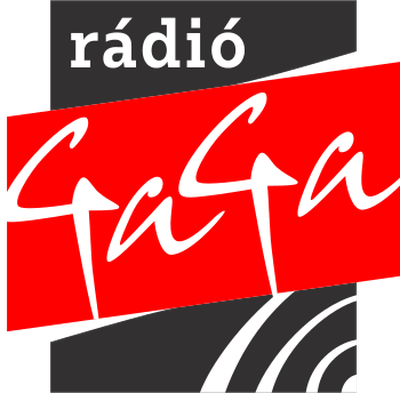

# Station fixes, 2026-10-17

The thirteen stations with the most failed plays in Sentry over the last seven days were probed from Romania
(`scripts/Test-StationStreams.ps1`, then `ffprobe` for the codec). Two urls change; GUIDs, titles, categories and
logos do not, so listeners' favorites keep working. Every RoRadio app downloads the list from
[GitHub Pages](https://ventura8.github.io/RoRadioResources/RadioStationsData.json), so the fix needs no app update.

## Changed

| Logo | Station | Was | Now | Evidence |
| :---: | :--- | :--- | :--- | :--- |
|  | Radio Dor | `http://ivm.antenaplay.ro/liveaudio/radiodor/playlist.m3u8` | `https://ivm.antenaplay.ro/liveaudio/radiodor/playlist.m3u8` | The http url answers `301 Moved Permanently` to the same playlist over https. Probe: `alive`, followed to its first segment (HE-AAC v2, 44.1 kHz stereo, 48 kbps). |
|  | Radio Gaga | `http://rc.radiogaga.ro:8000/live` | `https://stream.igenbiza.com/vas` | The old server answers every path with `302 Found` to `https://a3.my-control-panel.com:6660/radio.mp3`, a Shoutcast 1 server that replies "ICY 200 OK" over https (Media Foundation reported `unsupportedCodec`). radio-browser lists that server as Rádió GaGa Marosszék, and [the station's own player](https://www.radiogaga.ro/radio-player/?station=4) plays Marosszék from `https://stream.igenbiza.com/vas`. Probe: `alive`, HTTP 200, `audio/mpeg`, `icy-name` "Radio GaGa", `icy-url` `www.radiogaga.ro`, MP3 192 kbps. |

## Alive, left as they are

These answer with audio Media Foundation plays (HTTP 200, the codec below); their failures are intermittent, and a
new url would not fix them.

| Station | Url | Probe |
| :--- | :--- | :--- |
| Radio Zu | `https://ivm.antenaplay.ro/liveaudio/radiozu/playlist.m3u8` | `alive`; HLS, HE-AAC v2 48 kbps. The master playlist is served as `text/html` and the segments as `application/octet-stream` (packed ADTS). |
| Kiss FM | `http://live.kissfm.ro/kissfm.aacp` | `alive`; `audio/aac`, AAC LC 80 kbps. The same mount answers over https. |
| Virgin Radio | `https://astreaming.edi.ro:8443/VirginRadio_aac` | `alive`; `audio/aac`, AAC LC 64 kbps. |
| Europa FM | `http://astreaming.europafm.ro:8000/EuropaFM_aac` | `alive`; `audio/aac`, AAC LC 64 kbps. The same mount answers over https on `astreaming.edi.ro:8443`. |
| Radio România Actualități | `http://89.238.227.6:8006/` | `alive`; `audio/aacp`, `icy-name` "Radio Romania Actualitati", AAC LC 128 kbps. |
| RVE Suceava | `https://stream.rvesv.ro/rvesv.mp3` | `alive`; `audio/mpeg`, MP3 128 kbps. |
| Magic FM | `https://live.magicfm.ro/magicfm.aacp` | `alive`; `audio/aac`, AAC LC 80 kbps. |
| Sport Total FM | `https://livesptfm.com/SPTFM/Audio128/playlist.m3u8` | `alive`; HLS, AAC LC 48 kHz 128 kbps. |
| Radio Impuls | `https://live.radio-impuls.ro/stream` | `alive`; `audio/mpeg`, MP3 192 kbps. |
| Gold FM | `http://80.86.106.110:8020/radiogoldfm-32.aac` | `alive`; `audio/aacp`, `icy-name` "Radio Gold FM", AAC LC 32 kbps. |

## Unresolved

| Station | Url | What was tried |
| :--- | :--- | :--- |
| Radio Luceafar | `http://live.radioluceafar.com:8000/;` | The stream host no longer resolves, and radioluceafar.com shows a Cloudflare 521 (its last archived page is a blank nginx page). myradioonline.ro and TuneIn point to `https://ssl.radios.show:7018/;`, but that server now carries "Inclusive Radio" (international pop), not this station; TuneIn's other url (`ssl.radios.show:8038`) does not answer. radio-browser, the Shoutcast directory, radio.garden and Zeno have no Radio Luceafar. The station stays in the list for the owner to decide. |
